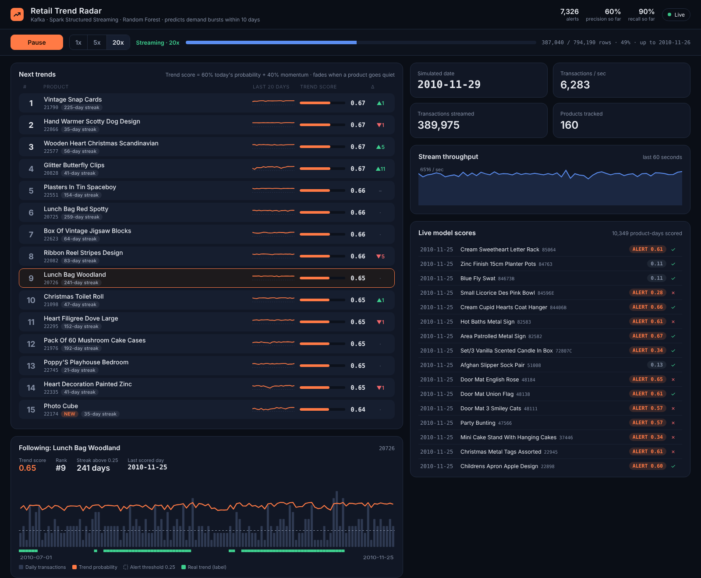
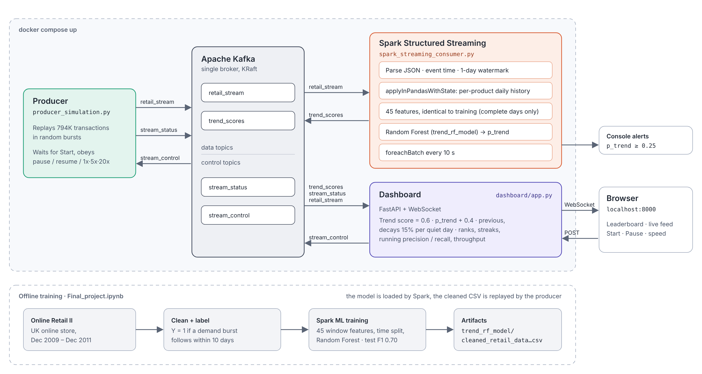
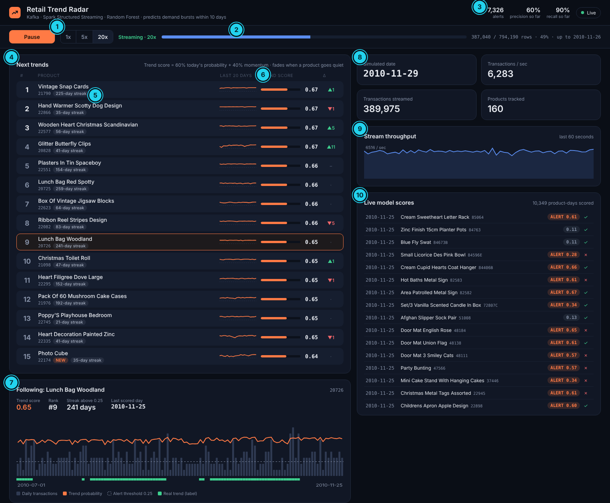
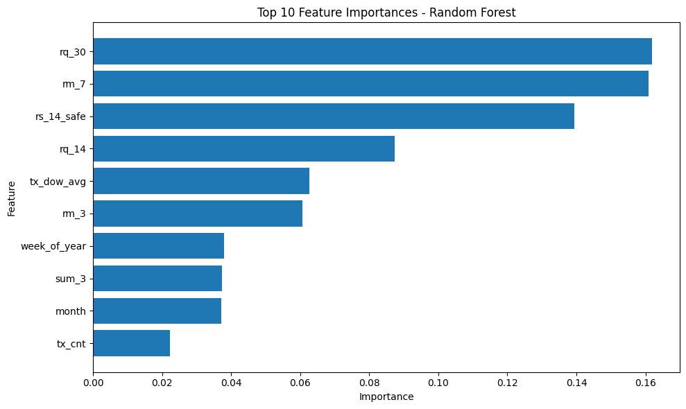
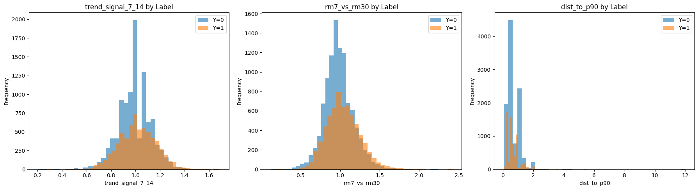

# Real-Time Trend Detection in E-Commerce Streams

*Detecting emerging product trends from a live transaction stream with Apache Kafka, Spark Structured Streaming and a Random Forest classifier, with a live web dashboard.*

**Course:** Big Data Analysis &nbsp;|&nbsp; **Stack:** Apache Kafka · PySpark 3.5 · Spark ML · FastAPI · WebSocket · Docker



---

## Project Overview

Batch analytics usually surface a trend only after it has already peaked. The challenge is to separate real emerging trends from noisy fluctuations in a highly imbalanced setting.

This system replays real e-commerce transactions into Kafka, keeps per-product history with Spark Structured Streaming, computes 45 behavioral features incrementally, and scores every completed product-day with a pre-trained Random Forest. The model predicts whether a product will have a demand burst **within the next 10 days**. A live dashboard ranks the products most likely to trend next and lets you control the simulation.

Data: [Online Retail II](https://archive.ics.uci.edu/dataset/502/online+retail+ii), a UK online retailer, December 2009 to December 2011.


*Daily transaction volume across the full dataset, the activity the streaming pipeline monitors per product.*

---

## System Architecture



| Component | What it does |
|---|---|
| **Producer** (`producer_simulation.py`) | Replays the 794K cleaned transactions into `retail_stream` in random bursts. Waits for **Start** from the dashboard and follows pause, resume and speed commands from `stream_control`. Reports its progress on `stream_status`. |
| **Kafka** | Single broker in KRaft mode. Data topics: `retail_stream`, `trend_scores`. Control topics: `stream_control`, `stream_status`. |
| **Spark Structured Streaming** (`spark_streaming_consumer.py`) | Parses the stream with a 1-day watermark. `applyInPandasWithState` keeps each product's daily history, computes the 45 features and scores them with the Random Forest. Every 10 seconds `foreachBatch` publishes all scores to `trend_scores` and prints the alerts (p_trend ≥ 0.25). |
| **Dashboard** (`dashboard/`) | FastAPI service that reads `trend_scores`, `stream_status` and `retail_stream`, keeps the ranking state and pushes a snapshot to the browser every second over WebSocket. Sends control commands to `stream_control`. |
| **Offline training** (`Final_project.ipynb`) | Cleaning, labeling, feature engineering, model selection and evaluation. Produces `trend_rf_model/` and the cleaned dataset that the producer replays. |

**Design points**

- **Complete days only.** A day's transactions can arrive across several micro-batches. The open day is accumulated in state and scored once the product's next day arrives, so every score uses the full day, like the training data.
- **Training/serving parity.** The streaming features reproduce the notebook's Spark window features exactly: same windows over previous active days, sample standard deviation, Spark weekday numbering, `percentile_approx` semantics and the same minimum-history rule (31 active days). This was verified row-by-row against the training code.
- **Fault tolerance.** Kafka offsets and the per-product state are checkpointed to `checkpoint/retail_streaming`.
- **Ground truth in the demo.** `Y` travels with the simulated stream only so the dashboard can show whether each prediction matched reality.

---

## Quick Start (Windows, macOS, Linux)

Everything runs in Docker, so there is nothing else to install: no Java, Spark, Kafka or Python setup.

### 1. Prerequisites

Install [Docker Desktop](https://www.docker.com/products/docker-desktop/) and start it. On Windows it uses WSL 2, which the installer sets up. Wait until Docker Desktop shows **Engine running**. Give Docker at least 4 GB of memory (Settings → Resources).

### 2. Get the code

```bash
git clone https://github.com/shahar-eliyahu/real-time-retail-trend-detection.git
cd real-time-retail-trend-detection
```

### 3. Build and start everything

```bash
docker compose up --build
```

This starts Kafka, creates the four topics, builds the Spark image, and starts the Spark consumer, the producer and the dashboard. The first build takes about 5 to 10 minutes because it downloads Java, Spark and the Kafka connector. Later starts take seconds.

The system is ready when the log shows `waiting for Start from the dashboard`.

### 4. Open the dashboard and press Start

Open **http://localhost:8000** and press **Start**. Nothing is streamed until you do. Products need about a month of simulated history before they get their first score, so the leaderboard fills after a few minutes at 1x, or within a minute at 20x.

### Everyday commands

| Task | Command |
|---|---|
| Start (build only the first time or after code changes) | `docker compose up --build` |
| Start in the background | `docker compose up -d` (then stop with `docker compose down`) |
| Follow the alerts printed by Spark | `docker compose logs -f consumer` |
| Follow the producer | `docker compose logs -f producer` |
| See what is running | `docker compose ps` |
| Stop | `Ctrl+C`, then `docker compose down` |
| Run again from the beginning | `docker compose up` |
| Stop and delete the downloaded and built images | `docker compose down --rmi all` |

### Addresses

| Service | URL |
|---|---|
| Dashboard | http://localhost:8000 |
| Spark UI | http://localhost:4040 |
| Kafka from your own machine | `localhost:9094` |

You can also open the dashboard already following a product, for example http://localhost:8000/#20726.

### Troubleshooting

| Problem | Fix |
|---|---|
| `docker` is not recognized | Start Docker Desktop, then open a new terminal. |
| The consumer stops with a memory error | Raise Docker's memory to 4 GB or more (Settings → Resources). |
| `port is already allocated` (8000, 4040 or 9094) | Another program uses the port. Stop it, or change the left side of the port mapping in `docker-compose.yml`, for example `"8080:8000"`. |
| The dashboard says *Producer offline* | The producer container is still starting or has stopped. Check it with `docker compose logs producer`. |
| The leaderboard stays empty after Start | Wait a few minutes, or switch to 20x. Products are scored only after 31 active days. |

### Running without Docker (optional)

Kafka can stay in Docker while the Python parts run on your machine. This needs Python 3.11 and Java 17. Spark runs best on Linux, macOS or WSL; native Windows needs extra Hadoop setup.

```bash
docker compose up -d kafka create-topic
pip install -r requirements.txt

# terminal 1: Spark consumer
KAFKA_BOOTSTRAP=localhost:9094 python spark_streaming_consumer.py

# terminal 2: dashboard
cd dashboard && KAFKA_BOOTSTRAP=localhost:9094 NAMES_PATH=../product_trend_labels.csv uvicorn app:app --port 8000

# terminal 3: producer (AUTO_START=false makes it wait for Start in the dashboard)
KAFKA_BOOTSTRAP=localhost:9094 AUTO_START=false python producer_simulation.py
```

On Windows PowerShell, set each variable first, for example `$env:KAFKA_BOOTSTRAP="localhost:9094"`, then run the command.

### Re-running the notebook (optional)

The repository already contains the trained model and a compressed copy of the cleaned dataset (`cleaned_retail_data_with_Y.csv.gz`). To reproduce them, download `online_retail_II.xlsx` from the [UCI repository](https://archive.ics.uci.edu/dataset/502/online+retail+ii) into the project folder and run:

```bash
pip install -r requirements.txt jupyter openpyxl matplotlib
jupyter notebook Final_project.ipynb
```

The notebook writes `cleaned_retail_data_with_Y.csv`, `product_trend_labels.csv` and `trend_rf_model/`. The producer uses the uncompressed CSV when it exists.

---

## Using the Dashboard



1. **Simulation controls.** **Start** begins streaming, then the same button switches between **Pause** and **Resume**. **1x / 5x / 20x** sets the replay speed. Commands go to the producer through Kafka.
2. **Progress.** Simulation state, rows streamed out of 794K, and the latest transaction date sent.
3. **Model accuracy so far.** Total alerts (scores ≥ 0.25), and running precision and recall against the real labels. *Live* means the browser is connected.
4. **Next trends.** The 15 products most likely to trend, ranked by **trend score**: `0.6 × today's p_trend + 0.4 × previous score`. The score drops 15% for every simulated day without a new score. A product that keeps scoring high stays at the top, and a one-off spike fades quickly. A brand-new product enters with its first score. Click a row to follow that product.
5. **Product badges.** Product code, `NEW` for a product that entered the top 15 in the last two simulated days, and the streak of consecutive scored days above the 0.25 alert threshold.
6. **Trend columns.** Sparkline of the last 20 probabilities (dotted line = 0.25 threshold), the trend score bar, and Δ, the rank change since the previous simulated day.
7. **Following.** History of the selected product: bars are daily transactions, the orange line is the model's trend probability, the dashed line is the alert threshold, and green marks the days that really were trends. It keeps following the product even after it leaves the top 15.
8. **Live stream.** Simulated date, transactions per second, transactions streamed, and products the model has scored so far.
9. **Stream throughput.** Transactions per second over the last 60 seconds. The dips are pauses.
10. **Live model scores.** Every scored product-day as it arrives: date, product, probability (orange `ALERT` at 0.25 or more), and ✓ or ✗ for whether the prediction matched the label.

The ranking updates in steps of about 10 seconds, the interval of Spark's micro-batches. Restarting only the dashboard replays `trend_scores` from the beginning, so the ranking is rebuilt and nothing is lost.

---

## Machine Learning & Model Experiments

**Label.** A product-day is `Y = 1` if a significant demand burst occurs within the next **H = 10 days**: a minimum volume, deviation from recent and long-term behavior, and a minimum number of unique customers. All statistics use past data only. Positive rate: 10% of product-days.

**Split.** Chronological: train before 2011-08-15, validation until 2011-10-01, test after.

### Stage-1: Candidate Detection (Validation)

Several classifiers were evaluated on the validation set. Random Forest achieved the best F1 score and was selected as the Stage-1 model.

| Model | Threshold | Precision | Recall | F1 | Alerts |
|---|---|---|---|---|---|
| **Random Forest** | 0.25 | 0.6054 | 0.8459 | **0.7058** | 15,599 |
| GBT | 0.30 | 0.5701 | 0.9076 | 0.7003 | 17,773 |
| HistGradientBoosting | 0.30 | 0.5537 | 0.9233 | 0.6922 | 18,618 |
| XGBoost | 0.30 | 0.5568 | 0.9177 | 0.6931 | 18,400 |

GBT, HistGradientBoosting and XGBoost were evaluated with the same train/validation split. Their training cells are commented out in the notebook to avoid re-running expensive experiments.


*The rolling 90th percentile and the 7-day rolling mean of daily transactions are the strongest signals.*


*Trending (Y=1) and non-trending (Y=0) product-days separate most clearly on `dist_to_p90`.*

### Stage-2: False Positive Filtering (Validation)

A second stage was explored to improve precision: Stage-1 produces high-recall candidates, and a Stage-2 model retrained on those harder cases filters false positives.

| Model | Precision | Recall | F1 | Alerts |
|---|---|---|---|---|
| **Random Forest** | 0.7460 | 0.9159 | **0.8223** | 6,441 |
| Logistic Regression | 0.7290 | 0.9424 | 0.8221 | 6,782 |
| GBT | 0.7591 | 0.8180 | 0.7874 | 5,653 |


*Threshold sweep for the Stage-2 Random Forest: 0.35 sits at the F1 peak.*

### Final Evaluation on the Test Set

| Pipeline | Precision | Recall | F1 | Alerts |
|---|---|---|---|---|
| **Stage-1 only (deployed)** | 0.5780 | 0.8811 | 0.6980 | 38,122 |
| Two-stage pipeline | 0.5802 | 0.8763 | 0.6982 | 37,771 |


*Daily transactions, rolling mean and rolling 90th percentile for a product labeled as trending.*

### Architecture Decision

On unseen data the second stage brought no meaningful gain (F1 0.6982 vs 0.6980). The deployed system therefore uses the **single Random Forest** (100 trees, depth 6, threshold 0.25) for a simpler pipeline and lower latency.

| Metric | Value |
|---|---|
| Test F1 | 0.698 |
| Recall | 0.881 |
| Precision | 0.578 |
| Features | 45 |
| Positive rate | 10.0% of product-days |
| Prediction horizon | 10 days |

---

## Project Structure

```
├── docker-compose.yml              Kafka, topics, Spark consumer, producer, dashboard
├── Dockerfile                      Python 3.11 + Java 17 + PySpark image
├── requirements.txt
├── producer_simulation.py          Kafka producer with start / pause / speed control
├── spark_streaming_consumer.py     Stateful features + Random Forest scoring
├── dashboard/
│   ├── app.py                      FastAPI + WebSocket backend, trend score logic
│   └── static/index.html           Single-page dashboard
├── trend_rf_model/                 Trained Spark ML Random Forest
├── cleaned_retail_data_with_Y.csv.gz   Cleaned, labeled transactions replayed by the producer
├── product_trend_labels.csv        Product names and product-level labels
├── Final_project.ipynb             Full offline pipeline: EDA, labels, features, training
├── images/                         Notebook charts
└── docs/                           Architecture diagram and dashboard screenshots
```

---

## Limitations & Future Work

- **Heuristic labels.** Trends are defined by statistical thresholds, not manual ground truth.
- **False positives.** Short-lived spikes can still trigger alerts.
- **One-day scoring delay.** A day is scored when the product's next active day arrives, so a product's last day in the stream is never scored.
- **Single machine.** The design scales out by adding Kafka partitions and Spark executors.
