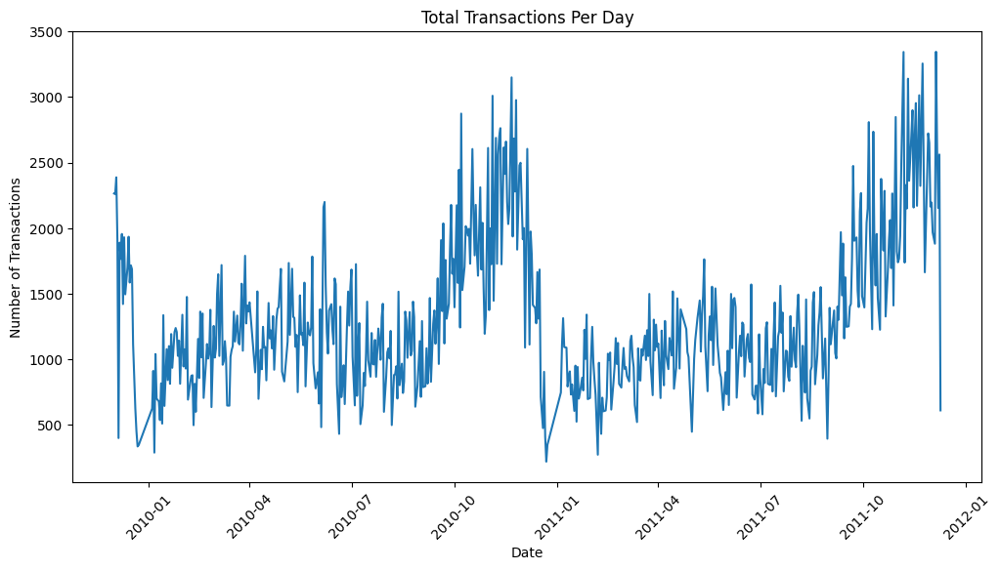
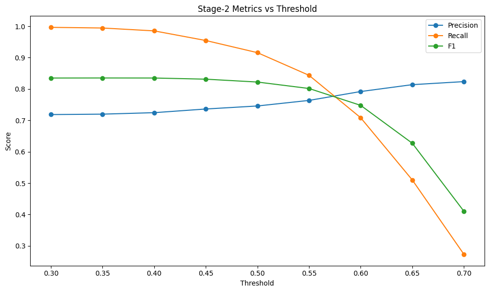
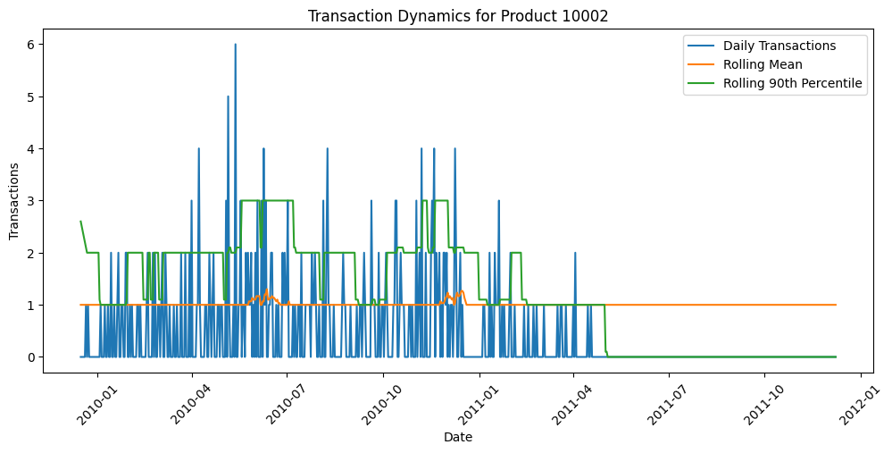

# Real-Time Trend Detection in E-Commerce Streams

*Detecting emerging product trends from a live transaction stream using Apache Kafka, Spark Structured Streaming, and a Random Forest classifier.*

**Course:** Big Data Analysis &nbsp;|&nbsp; **Stack:** Apache Kafka · PySpark 3.5 · Python · Random Forest · Structured Streaming

---

## Project Overview

Traditional batch processing systems suffer from data freshness issues — insights are often computed hours or days after a trend has already peaked. The core challenge lies in distinguishing true emerging trends from noisy fluctuations in a highly imbalanced environment.

This system addresses the problem by enabling immediate detection. The pipeline ingests a stream of transactions via Apache Kafka, maintains per-product historical state using Spark Structured Streaming, computes up to 45 behavioral features incrementally, and applies a trained Random Forest model to generate alerts in real time.

The system processes data in near real time using micro-batches, enabling fast reaction to emerging trends.


*Daily transaction volume across the full dataset — the underlying activity the streaming pipeline monitors per product.*

---

## System Architecture

```
Producer (producer_simulation.py)
        |
        v
  Kafka Topic: retail_stream
        |
        v
  Spark Structured Streaming
    |-- withWatermark ("ts", "1 day")
    |-- applyInPandasWithState (60-day history per product)
    |-- RandomForest Model (Inference)
        |
        v
  Alerts: ProductID | Day | Y
```

**Key components:**

- **Apache Kafka** – Unified under `retail_stream`.
- **Fault Tolerance** – Checkpoints are persisted in `checkpoint/retail_streaming` for recovery.
- **Watermarking** – A 1-day watermark is included as a foundation for handling late-arriving data, while the current simulation mostly produces ordered events.
- **Stateful Processing** – Uses `applyInPandasWithState` to compute momentum and Z-scores without full recomputation.

> **Implementation choice:** We used `applyInPandasWithState` instead of the standard `mapGroupsWithState`. In our PySpark environment, this approach provided better stability and allowed for more seamless integration with our Pandas-based feature engineering logic.

---

## Machine Learning & Model Experiments

### Stage-1: Candidate Detection (Validation)

Several classifiers were evaluated on the validation set. Random Forest achieved the best F1 score and was selected as the Stage-1 model.

| Model | Threshold | Precision | Recall | F1 | Alerts |
|---|---|---|---|---|---|
| **Random Forest** | 0.25 | 0.6054 | 0.8459 | **0.7058** | 15,599 |
| GBT | 0.30 | 0.5701 | 0.9076 | 0.7003 | 17,773 |
| HistGradientBoosting | 0.30 | 0.5537 | 0.9233 | 0.6922 | 18,618 |
| XGBoost | 0.30 | 0.5568 | 0.9177 | 0.6931 | 18,400 |

GBT, HistGradientBoosting, and XGBoost were evaluated as alternative Stage-1 candidates using the same train/validation split (their training cells are kept commented out in the notebook to avoid re-running expensive experiments, with results summarized here).


*The rolling 90th-percentile and 7-day rolling mean of daily transactions are the strongest signals for the Random Forest model.*


*Trending (Y=1) and non-trending (Y=0) product-days separate more clearly on `dist_to_p90` than on the two rolling-ratio features, consistent with it ranking among the top features above.*

---

### Stage-2: False Positive Filtering (Validation)

To further improve precision, a two-stage approach was explored:

- **Stage-1** generates candidates with high recall (captures most trends).
- **Stage-2** filters false positives among those candidates.

While Random Forest was also used in Stage-1, its reuse in Stage-2 is intentional. In Stage-1 the model serves as a high-recall filter, whereas in Stage-2 it is retrained on a more challenging subset of data to refine predictions and reduce false positives. This multi-stage approach allows the same model architecture to specialize in different tasks across the pipeline.

| Model | Precision | Recall | F1 | Alerts |
|---|---|---|---|---|
| **Random Forest** | 0.7460 | 0.9159 | **0.8223** | 6,441 |
| Logistic Regression | 0.7290 | 0.9424 | 0.8221 | 6,782 |
| GBT | 0.7591 | 0.8180 | 0.7874 | 5,653 |

**Random Forest was selected as the Stage-2 model** based on F1 score, with a final threshold of 0.35.


*Threshold sweep for the Stage-2 Random Forest model — 0.35 sits at the F1 peak before recall starts dropping off.*

---

### Final Evaluation on Test Set

| Pipeline | Precision | Recall | F1 | Alerts |
|---|---|---|---|---|
| Stage-1 only | 0.5780 | 0.8811 | 0.6980 | 38,122 |
| Two-Stage pipeline | 0.5802 | 0.8763 | 0.6982 | 37,771 |

When evaluated on the held-out test set, the two-stage pipeline achieved very similar performance to Stage-1 alone, with only a marginal improvement in F1 score (0.6982 vs 0.6980). The two-stage pipeline slightly reduced the number of false positives and total alerts (by ~350 alerts), indicating a modest refinement of predictions.

---

### Results Summary

| Metric | Value |
|---|---|
| Final Test F1 | 0.698 |
| Recall | 0.881 |
| Precision | 0.578 |
| Total Features | 45 |
| Positive Rate | 10.0% |
| Prediction Horizon | H = 10 days |

The positive rate is 10.0% at the product-day level (used for model construction). After merging back to the transaction level, it appears higher (43%) because all individual transactions on a labeled trend day inherit the positive label.


*Daily transactions, rolling mean, and rolling 90th percentile for a product flagged as trending (Y=1) — the signal the labeling logic and the model are built around.*

---

## Architecture Decision

Since the second stage provided no measurable improvement on unseen data, the final system uses a **single Random Forest model**. This simplifies the pipeline without any loss in performance.

Although the two-stage pipeline was tested to reduce false positives, the final evaluation on unseen test data showed that **Stage-1 (Random Forest) already captures the trend dynamics effectively (F1 ≈ 0.70)**. To minimize system complexity and reduce inference latency in a production environment, the single-stage model was selected for final deployment.

---

## Real-Time Data Streaming Setup & Execution

Before running the project, ensure that all required components are installed and properly configured.

This project depends on:

- Apache Kafka (3.2.1)
- Apache Spark (3.5.x)
- Python (Anaconda recommended)
- Python packages: `pandas`, `pyarrow`, `kafka-python`, `openpyxl`

> **Note:** Replace the placeholders below with your local paths:
> - `<kafka_path>` – path to Kafka directory
> - `<spark_path>` – path to Spark directory
> - `<project_folder>` – path to the project directory

Example:

- `<kafka_path> = ~/kafka_2.13-3.2.1`
- `<spark_path> = ~/spark`
- `<project_folder> = ~/projects/real-time-trends`

---

### 1. Clean Environment (Recommended)

If Spark or Python were previously installed, clean conflicting settings:

```bash
unset SPARK_HOME
unset PYTHONPATH
```

---

### 2. Install Python Dependencies

```bash
pip install pandas pyarrow kafka-python openpyxl
```

*(If using Conda: `conda install pandas`)*

---

### 3. Install Apache Kafka (if not installed)

```bash
wget https://archive.apache.org/dist/kafka/3.2.1/kafka_2.13-3.2.1.tgz
tar -xzf kafka_2.13-3.2.1.tgz
```

---

### 4. Install Apache Spark (if not installed)

```bash
wget https://archive.apache.org/dist/spark/spark-3.5.3/spark-3.5.3-bin-hadoop3.tgz
tar -xzf spark-3.5.3-bin-hadoop3.tgz
mv spark-3.5.3-bin-hadoop3 ~/spark
```

---

### 5. Configure Spark Environment

```bash
export SPARK_HOME=<spark_path>
export PATH=$SPARK_HOME/bin:$PATH
```

Verify installation:

```bash
spark-submit --version
```

---

### 6. Configure Python for Spark

Ensure Spark uses the correct Python environment:

```bash
export PYSPARK_PYTHON=$(which python)
export PYSPARK_DRIVER_PYTHON=$(which python)
```

Verify libraries:

```bash
python -c "import pandas; print(pandas.__version__)"
python -c "import pyarrow; print(pyarrow.__version__)"
```

---

### 7. Important Notes

- Kafka and Spark versions must be compatible.
- Topic name must match (`retail_stream`).
- If errors occur, re-run environment cleaning.

---

## Streaming Pipeline Execution

The following steps describe how to run the real-time streaming pipeline end-to-end.

To run a fresh simulation, first verify that the `checkpoint/` directory does not exist. If it does, delete it before proceeding.

Spark uses this directory to persist streaming state and offsets between runs. If not deleted, the consumer will resume from the last checkpoint instead of starting from scratch.

All steps must be executed in separate terminal windows, strictly in the following order:

---

### Terminal 1 – ZooKeeper

```bash
cd <kafka_path>
bin/zookeeper-server-start.sh config/zookeeper.properties
```

---

### Terminal 2 – Kafka Broker

```bash
cd <kafka_path>
bin/kafka-server-start.sh config/server.properties
```

---

### Terminal 3 – Create Topic (first time only)

```bash
cd <kafka_path>
bin/kafka-topics.sh --list --bootstrap-server localhost:9092
bin/kafka-topics.sh --create \
  --topic retail_stream \
  --bootstrap-server localhost:9092 \
  --partitions 1 \
  --replication-factor 1
```

> Skip topic creation if it already exists.

---

### Terminal 4 – Spark Consumer

```bash
cd <project_folder>

unset PYSPARK_DRIVER_PYTHON
unset PYSPARK_DRIVER_PYTHON_OPTS

$SPARK_HOME/bin/spark-submit \
  --packages org.apache.spark:spark-sql-kafka-0-10_2.12:3.5.3 \
  spark_streaming_consumer.py
```

---

### Terminal 5 – Producer

```bash
cd <project_folder>
python3 producer_simulation.py
```

---

## Example Real-Time Output

The following output is printed by the Spark consumer (`spark_streaming_consumer.py`) for each processed micro-batch.

```
-------------------------------------------
Batch: 22
-------------------------------------------
+----------+---------+---+
|Day       |ProductID|Y  |
+----------+---------+---+
|2010-05-19|20675    |1  |
|2010-05-19|20711    |1  |
|2010-05-18|20749    |1  |
|2010-05-18|15044A   |0  |
|2010-05-18|21121    |1  |
|2010-05-19|21125    |0  |
|2010-05-18|21155    |1  |
+----------+---------+---+
```

---

## Proposal vs. Implementation

| Feature | Original Proposal | Final Implementation | Justification |
|---|---|---|---|
| Time Analysis | Fixed Windows (1/5/10 min) | Adaptive Stateful | Captures trends across boundaries |
| Evaluation | System Latency/Accuracy | ML Metrics (F1-Score) | Focus on prediction quality |
| Segmentation | Customer Clustering | Product-level Trends | Focus on core problem |
| TTL | Automatic State Eviction | Bounded History (60 days) | Simpler and stable |
| Late Data | Watermarking/Event-time | Ordered simulation + watermark | Controlled environment with future support |

---

## Limitations & Future Work

- **Heuristic Labels:** Trends are defined by statistical thresholds rather than manual ground truth.
- **False Positives:** The system may generate alerts during sudden but short-lived spikes. Future work involves refining noise filters.
- **Local Scope:** Deployed on a single machine. The design is extensible to distributed clusters by scaling Kafka partitions and Spark executors.
- **Feature Simplification:** A small subset of advanced features was simplified in the online inference pipeline. The full feature set was explored in the offline modeling stage.

---

## Conclusion

This project demonstrates how combining stateful streaming with machine learning enables a shift from reactive analytics to proactive, real-time decision-making. By eliminating the computing tax of full recomputation, the system provides a scalable and robust framework for modern data-driven e-commerce.

The implementation successfully detects emerging product trends in real time, processing historical e-commerce transactions through an end-to-end streaming pipeline built in Python.
